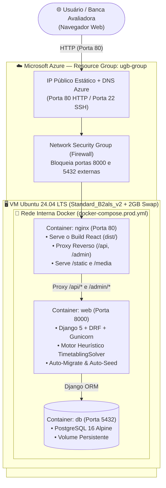

# ☁️ Guia Oficial de Deploy Automático — Microsoft Azure (Azure for Students)

> **Projeto:** EduSchedule Timetabling  
> **Provedor de Nuvem:** Microsoft Azure (*Plano Azure for Students* — Tenant `ugb.edu.br`)  
> **Grupo de Recursos:** `ugb-group`  
> **Região dos Recursos:** `mexicocentral` (Permitida pela Azure Policy da assinatura e com cota livre de IP Público)  
> **Tamanho da Máquina Virtual (SKU):** `Standard_B2ls_v2` (2 vCPUs Intel, 4 GB RAM + 2 GB Swap)  
> **Ferramentas de Automação:** Terraform + Docker Compose + PowerShell ([`deploy_azure.ps1`](file:///c:/Users/Pedro/DjangoDock/deploy_azure.ps1)) / GNU Make ([`Makefile`](file:///c:/Users/Pedro/DjangoDock/Makefile))

---

## 1. Visão Geral da Arquitetura em Produção

A arquitetura de produção foi desenhada para executar toda a pilha do **EduSchedule Timetabling** dentro de uma única Máquina Virtual Linux (**Ubuntu Server 24.04 LTS**) no grupo de recursos `ugb-group`, otimizando ao máximo os créditos do plano **Azure for Students**.



---

## 2. Preparação Realizada no Código para Produção

Para manter **100% de compatibilidade com o ambiente de desenvolvimento local** (`setup_dev.bat` e SQLite), os arquivos originais de desenvolvimento foram preservados e foram adicionados apenas os artefatos necessários para produção:

| Arquivo | Tipo | O que foi feito e por quê |
| :--- | :--- | :--- |
| [`backend/requirements.txt`](file:///c:/Users/Pedro/DjangoDock/backend/requirements.txt) | Modificado | Adicionados `gunicorn>=22.0.0` (servidor WSGI de produção) e `whitenoise>=6.6.0` (entrega otimizada de arquivos estáticos). |
| [`backend/eduschedule_backend/settings.py`](file:///c:/Users/Pedro/DjangoDock/backend/eduschedule_backend/settings.py) | Modificado | Adicionado suporte à variável `DJANGO_CSRF_TRUSTED_ORIGINS`, `STATIC_ROOT` e carregamento condicional do `WhiteNoiseMiddleware`. |
| [`backend/Dockerfile`](file:///c:/Users/Pedro/DjangoDock/backend/Dockerfile) | Modificado | Adicionada conversão automática de quebras de linha (`CRLF` $\rightarrow$ `LF`) para o script [`entrypoint.prod.sh`](file:///c:/Users/Pedro/DjangoDock/backend/entrypoint.prod.sh), evitando erros ao fazer deploy a partir do Windows. |
| [`backend/entrypoint.prod.sh`](file:///c:/Users/Pedro/DjangoDock/backend/entrypoint.prod.sh) | Novo | Script que roda automaticamente na subida do container em produção: executa `migrate`, `collectstatic`, popula o banco com `seed_data --with-solver` e inicia o **Gunicorn** com timeout de 120s. |
| [`frontend/Dockerfile`](file:///c:/Users/Pedro/DjangoDock/frontend/Dockerfile) | Novo | Build *multi-stage*: compila o projeto React + TypeScript + Vite no estágio `node:22-alpine` e copia os arquivos estáticos gerados (`dist/`) para a imagem leve `nginx:1.27-alpine`. |
| [`frontend/nginx.conf`](file:///c:/Users/Pedro/DjangoDock/frontend/nginx.conf) | Novo | Configura o Nginx na porta `80` para servir o React SPA e atuar como **Reverse Proxy** de `/api/` e `/admin/` para `http://web:8000`, além de servir `/static/` e `/media/` (fotos dos professores). |
| [`docker-compose.prod.yml`](file:///c:/Users/Pedro/DjangoDock/docker-compose.prod.yml) | Novo | Orquestrador exclusivo de produção contendo `db` (PostgreSQL 16 com *healthcheck*), `web` (Django + Gunicorn) e `nginx` (Frontend + Reverse Proxy) com volumes persistentes. |

---

## 3. Estrutura do Terraform (`terraform/`)

Os scripts de Infraestrutura como Código (IaC) ficam isolados na pasta [`terraform/`](file:///c:/Users/Pedro/DjangoDock/terraform):

* **[`terraform/versions.tf`](file:///c:/Users/Pedro/DjangoDock/terraform/versions.tf):** Define os providers `hashicorp/azurerm` e `hashicorp/random`, com `skip_provider_registration = true` (evita erros de permissão comuns em contas *Azure for Students*).
* **[`terraform/variables.tf`](file:///c:/Users/Pedro/DjangoDock/terraform/variables.tf):** Centraliza os parâmetros da infraestrutura:
  * `resource_group_name = "ugb-group"`
  * `vm_size = "Standard_B2als_v2"`
  * `admin_username = "azureuser"`
  * `ssh_public_key_path = "~/.ssh/id_rsa.pub"`
* **[`terraform/main.tf`](file:///c:/Users/Pedro/DjangoDock/terraform/main.tf):**
  * **Proteção do `ugb-group`:** Utiliza `data "azurerm_resource_group" "rg"` para referenciar o grupo `ugb-group`. Assim, a VM e a rede herdam automaticamente a região do seu grupo, e caso você execute `make destroy` no futuro, **apenas os recursos do EduSchedule são removidos**, sem apagar o grupo `ugb-group` nem outros trabalhos acadêmicos que estejam nele.
  * **Rede e Segurança:** Cria VNet (`10.10.0.0/16`), Subnet, IP Público Estático com DNS gratuito da Azure (`eduschedule-ugb-xxxxx.<regiao>.cloudapp.azure.com`) e Firewall (NSG) liberando exclusivamente as portas `22` (SSH) e `80` (HTTP).
* **[`terraform/cloud-init.yaml`](file:///c:/Users/Pedro/DjangoDock/terraform/cloud-init.yaml):** Executado automaticamente pela Azure no primeiro boot da VM:
  1. Aloca e ativa **2 GB de memória Swap** (`/swapfile`).
  2. Instala o **Docker Engine** e o **Docker Compose v2** dos repositórios oficiais.
  3. Prepara o diretório `/opt/eduschedule` e grava a flag `.cloud-init-ready` ao terminar.
* **[`terraform/outputs.tf`](file:///c:/Users/Pedro/DjangoDock/terraform/outputs.tf):** Exibe o IP público, o domínio DNS da Azure e o comando SSH ao final do provisionamento.

---

## 4. Como Executar o Deploy Automático (Passo a Passo)

### Pré-requisitos na sua máquina
1. **Azure CLI (`az`)** instalado ([Download aqui](https://aka.ms/installazurecli)).
2. **Terraform** instalado ([Download aqui](https://developer.hashicorp.com/terraform/install)).
3. **Terminal com suporte a `make`, `ssh` e `tar`** (no Windows, recomendamos usar o terminal **Git Bash** ou **WSL2**; caso esteja no PowerShell, instale o Make via `winget install GnuWin32.Make` ou execute pelo Git Bash).

---

### Passo 1: Autenticar no Azure CLI
No terminal, faça login na sua conta **Azure for Students**:

```bash
az login
```

Verifique se a assinatura ativa é a sua conta de estudante:

```bash
az account show --output table
```

---

### Passo 2: Executar o Deploy Completo em 1 Comando
Na raiz do projeto, execute pelo **PowerShell** (Windows) ou **Make** (Linux/macOS/Git Bash):

```powershell
# No Windows (PowerShell):
powershell -ExecutionPolicy Bypass -File .\deploy_azure.ps1 deploy
```

```bash
# No Linux / macOS / Git Bash:
make deploy-all
```

#### O que o `make deploy-all` faz automaticamente por trás dos panos?
1. **`check-env`:** Verifica se `az`, `terraform` e `ssh` estão instalados. Se você ainda não tiver uma chave SSH em `~/.ssh/id_rsa`, ele **gera o par de chaves automaticamente** sem pedir confirmação.
2. **`ensure-rg`:** Consulta o Azure para saber se o grupo de recursos `ugb-group` já existe. Se já existir, reutiliza o grupo na região em que ele está; se não existir, cria o `ugb-group` automaticamente.
3. **`infra-init` & `infra-up`:** Executa `terraform init` e `terraform apply -auto-approve`, provisionando a VM `Standard_B2als_v2` no `ugb-group`.
4. **`wait-vm`:** Conecta via SSH em loop controlado aguardando o `cloud-init` terminar de instalar o Docker e configurar o Swap na VM.
5. **`app-deploy`:**
   * Compacta o código local em um pacote leve (`deploy_bundle.tar.gz`), ignorando pastas pesadas (`node_modules`, `.venv`, `.git`, `db.sqlite3`).
   * Transfere o pacote via `scp` para `/opt/eduschedule` na VM.
   * Gera o arquivo `.env` de produção na VM já preenchido com o IP Público e o DNS da Azure em `DJANGO_ALLOWED_HOSTS` e `DJANGO_CSRF_TRUSTED_ORIGINS`.
   * Executa `docker compose -f docker-compose.prod.yml up -d --build`, que compila o frontend React, sobe o PostgreSQL 16, roda as migrações do Django, popula os dados iniciais (`seed_data --with-solver`) e disponibiliza o sistema na porta `80`.

Ao concluir, o terminal exibirá os links prontos:
* 🌐 **Acesso por IP:** `http://<IP_DA_VM>`
* 🌐 **Acesso por DNS Azure:** `http://eduschedule-ugb-xxxxx.<regiao>.cloudapp.azure.com`
* ⚙️ **API REST:** `http://<IP_DA_VM>/api/`
* 🔐 **Django Admin:** `http://<IP_DA_VM>/admin/`

---

## 5. Atualizando a Aplicação após Mudanças no Código

Quando você ou a equipe fizerem alterações no código (Frontend, Backend ou Solver) e quiserem atualizar a VM no Azure **sem recriar a infraestrutura**, basta rodar:

```bash
make app-deploy
```

Esse comando leva poucos segundos para enviar o código atualizado e reconstruir apenas os containers necessários.

---

## 6. Guia de Operação e Economia de Créditos (Azure for Students)

No plano **Azure for Students** (\$100 de crédito anual), a maior cobrança vem do tempo em que a Máquina Virtual permanece ligada (*Running*). O [`Makefile`](file:///c:/Users/Pedro/DjangoDock/Makefile) inclui comandos dedicados para você economizar seus créditos:

| Comando | Descrição | Impacto nos Créditos Azure |
| :--- | :--- | :--- |
| `make status` | Mostra os containers ativos (`docker compose ps`) e o uso de RAM/Swap da VM. | — |
| `make logs` | Exibe os logs em tempo real do Nginx, Gunicorn/Django e PostgreSQL direto da VM. | — |
| `make ssh` | Abre o terminal interativo dentro da VM Ubuntu no Azure. | — |
| **`make stop-vm`** | **Desaloca a VM no Azure** (`az vm deallocate`). Os dados do banco ficam salvos no disco, mas a cobrança de CPU e RAM **cai para zero**! | 💰 **Economia máxima** quando não estiver apresentando |
| **`make start-vm`** | Liga novamente a VM desalocada (`az vm start`). Como os containers têm `restart: unless-stopped`, o sistema volta ao ar sozinho em ~30 segundos! | Retoma o uso normal |
| **`make destroy`** | Remove completamente a VM, Disco, IP e VNet da aplicação via Terraform, **preservando intacto o grupo `ugb-group`**. | 💰 **Custo zero absoluto** |

---

## 7. Solução de Problemas Comuns (Troubleshooting)

1. **Erro `SkuNotAvailable` ou `OperationNotAllowed` durante o `make infra-up`:**
   * Contas *Azure for Students* às vezes restringem determinadas famílias de VM dependendo da região onde o grupo `ugb-group` foi criado.
   * Caso a região atual do `ugb-group` não tenha capacidade para `Standard_B2als_v2`, você pode alterar a variável `vm_size` em [`terraform/variables.tf`](file:///c:/Users/Pedro/DjangoDock/terraform/variables.tf#L13-L17) para `"Standard_B2s"` ou `"Standard_B2ats_v2"`.
2. **No Windows, o comando `make` não é reconhecido no PowerShell:**
   * Abra o terminal **Git Bash** (que já vem instalado junto com o Git for Windows) na pasta do projeto, ou instale o GNU Make no PowerShell rodando:
     ```powershell
     winget install GnuWin32.Make
     ```

